# ICT401 · Semana 12 — Registro de formato, cajetín y salidas técnicas

5 al 10 de octubre de 2026.

- Estudiante: Nahomy Huertas Esquivel
- Grupo: 60
- Proyecto de Fusion Cloud con acceso docente: Nahomy Huertas
- Drawing de referencia de Semana 11: S09_P3_Modelo_Huertas_Nahomy
- Modelo utilizado: S09_P3_Modelo_Huertas_Nahomy
- Laboratorio integrador II-A: Completado
- Fase 2 del Proyecto: entregado

## Instrucciones

Utilice esta plantilla en la carpeta o plataforma oficial de entrega indicada por la persona docente y guárdela como `S12_Registro_Apellido_Nombre.md`. Sustituya `Apellido_Nombre` por un apellido y un nombre sin espacios ni tildes. Complete cada `[Respuesta]` y agregue las imágenes solicitadas junto con la ficha.

Conserve las decisiones iniciales y documente las correcciones. No borre una decisión anterior: explique qué cambió, qué problema motivó el cambio y cómo comprobó el resultado.

Trabaje sobre el modelo y el Drawing de Semana 11. Use milímetros, orientación coherente y el mismo proyecto de Fusion Cloud. Esta ficha registra el proceso; complétela durante cada lección, no al final de memoria.

**Ayuda de Fusion:** para comandos de Drawing consulte Autodesk Fusion Help, sección `Drawings`: <https://help.autodesk.com/view/fusion360/ENU/>. En esta ficha se utilizan `Design > File > New Drawing > From Design`, `Output > PDF`, `Output > DXF`, `Output > Print`, `Edit Sheet` y `Edit Title Block`. Si su versión utiliza otra etiqueta, escriba el nombre real del comando y adjunte la captura del cuadro o panel utilizado.

**Límite:** no modifique la geometría para resolver problemas de formato. No adelante ensamblajes, vistas explosionadas, fabricación digital ni control dimensional metrológico.

## Cómo funciona el Laboratorio integrador II-A

El laboratorio es un proceso acumulativo de cinco etapas. **P1, P2, P3 y P4 son prácticas formativas**: en cada una toma una decisión, realiza una corrección y conserva evidencias para continuar. **P5 no es un plano nuevo ni una actividad independiente**; utiliza el Drawing corregido durante P1–P4 para realizar la revisión final, comprobar las salidas y organizar la entrega.

| Etapa | Función | Resultado que pasa a la siguiente etapa |
|---|---|---|
| P1 | Diagnosticar el plano y seleccionar formato, orientación y escala. | Decisión justificada y estado inicial documentado. |
| P2 | Aplicar la hoja, distribuir vistas y completar el cajetín. | Drawing organizado y correcciones registradas. |
| P3 | Controlar escala, legibilidad, cotas, tolerancias y anotaciones. | Drawing validado o correcciones pendientes identificadas. |
| P4 | Exportar PDF/DXF y comparar las salidas con el Drawing. | Archivos revisados y discrepancias corregidas o registradas. |
| P5 | Integrar, revisar, imprimir y entregar el plano final. | Producto evaluable y evidencias finales. |

P5 corresponde al **Laboratorio integrador II-A, con valor de 10 %**. La **Fase 2 del Proyecto, con valor de 7 %**, utiliza este mismo proceso y registro, pero se entrega además conforme a su enunciado y rúbrica oficiales. Conserve las decisiones y capturas de P1–P4: forman parte de la trazabilidad del laboratorio y no se sustituyen por una sola captura del resultado final.

## Criterios normativos transversales

Use las referencias normativas disponibles en el aula virtual como criterios de control. No declare conformidad normativa solo porque el archivo tenga la extensión correcta o porque una configuración sea la predeterminada de Fusion.

| Referencia | Qué se revisa en esta semana | Evidencia o registro requerido |
|---|---|---|
| ISO 5457 | Formato, orientación, marco y zona útil de la hoja. | Decisión de formato justificada y captura de la hoja completa. |
| INTE/ISO 7200:2008, 5--6 | Espacios de información y composición del cajetín. | Campos identificables, número de identificación, fecha, título, autor, estado o revisión y datos de hoja cuando correspondan. |
| ISO 128-1:2020 e ISO 128-3 | Coherencia de representación, vistas, cortes y secciones. | Alineación, identificación de corte o detalle y comparación con el modelo. |
| ISO 129-1:2018, 4--6 | Necesidad, unicidad, ubicación y legibilidad de cotas; revisión de tolerancias existentes. | Tabla de control de anotaciones y capturas ampliadas. |
| ISO 16792:2021, 4--5.3 | Integridad y relación entre modelo, Drawing, archivos exportados, identificación y revisión. | Enlace de Fusion, nombres de archivos, versión o revisión y comparación de salidas. |

### Registro de aplicación normativa

| Referencia | Apartado o criterio aplicado | Evidencia asociada | Resultado o limitación |
|---|---|---|---|
| ISO 5457 | Selección del formato ISO A3 (420 × 297 mm), con orientación horizontal y marco con márgenes normalizados. | S12_P1_DecisionFormato_Huertas_Nahomy.png | Conforme. |
| INTE/ISO 7200:2008 | Organización del cajetín de título con el código ICT401, título del proyecto, autor (Nahomy Huertas), fecha y escala. | S12_P2_Cajetin_Huertas_Nahomy.png | Conforme. Limitación: algunos campos predeterminados del bloque de Fusion 360 aparecen en inglés. |
| ISO 128-1 / ISO 128-3 | Representación mediante vistas ortogonales, identificación del corte A-A y presentación del detalle B ampliado. | S12_P2_HojaDistribucion_Huertas_Nahomy.png | Conforme. |
| ISO 129-1 | Aplicación de criterios de acotación para evitar redundancias, colocar las cotas fuera del cuerpo de la pieza y comprobar la legibilidad de las tolerancias. | S12_P3_Legibilidad_Huertas_Nahomy.png | Conforme. |
| ISO 16792:2021 | Verificación de la correspondencia entre el modelo 3D, el plano técnico (*Drawing*) y los archivos exportados en PDF y DXF, procurando mantener la misma versión del diseño. | S12_P4_Comparacion_Huertas_Nahomy.png | Conforme. |

Si la plantilla o la versión de Fusion no permite mostrar un dato, escriba la limitación concreta. Las medidas propias de la actividad deben identificarse como decisiones didácticas, no como dimensiones ISO.

## P1 — Diagnóstico del plano y selección del formato

**Propósito:** analizar el Drawing de Semana 11 y seleccionar formato, orientación y escala inicial.

**Entorno:** Fusion, espacios `Design` y `Drawing`. En P1 no se modifica la geometría.

### P1.0 · Pasos en Fusion

1. Abra Fusion y seleccione el proyecto que contiene el modelo de Semana 11.
2. En `Design`, confirme que el cuerpo y las características coinciden con el Drawing anterior. No edite la geometría.
3. Abra el Drawing y confirme que aparecen vistas, corte o sección, detalle, cotas y tolerancias cuando correspondan.
4. En el navegador, seleccione la hoja y abra la opción de edición de hoja, normalmente `Edit Sheet`.
5. Registre formato, orientación y unidades actuales sin aplicar todavía cambios.
6. Observe la hoja completa y anote al menos tres problemas de espacio o legibilidad.
7. Compare las alternativas de formato de la plantilla.
8. Elija formato, orientación y escala inicial según la información que debe conservarse.
9. Guarde la justificación en esta ficha y conserve una captura del estado inicial.

### P1.1 · Estado de referencia

- Nombre del proyecto Fusion: Proyecto_ICT401_Salazar_Ashley
- Nombre del diseño: S09_P1_Modelo_Huertas_Nahomy
- Nombre del Drawing: S09_P1_Modelo_Huertas_Nahomy
- Formato actual: ISO A4 (210 × 297 mm)
- Orientación actual: Horizontal (Landscape)
- Unidades:  Milímetros (mm)
- Escala actual de la hoja o vistas: 1:2

### P1.2 · Diagnóstico

| Problema observado | Ubicación exacta en la hoja | Por qué afecta la entrega | Corrección prevista |
|---|---|---|---|
| Escala muy pequeña. | En las vistas principales del plano. | Hace que la pieza y sus detalles se vean pequeños, dificultando la lectura de las cotas. | Ajustar la escala para aprovechar mejor el espacio disponible en la hoja y facilitar la lectura. |
| Grosor de las líneas. | En los contornos, las líneas ocultas y los detalles del dibujo. | Si los grosores no se distinguen correctamente, puede ser difícil diferenciar los elementos de la pieza. | Revisar y ajustar los grosores de línea para mejorar la claridad del plano. |
| Distribución de la hoja. | En la distribución general de las vistas. | Una mala organización puede dejar espacios desaprovechados o hacer que las vistas y las cotas queden demasiado juntas. | Reorganizar las vistas y las anotaciones para aprovechar mejor el espacio y mantener una presentación ordenada. |

### P1.3 · Comparación de alternativas

| Alternativa | Ventaja | Limitación | ¿La selecciono? |
|---|---|---|---|
| ISO A4 (210 × 297 mm) | Es un tamaño estándar y fácil de imprimir. | No había suficiente espacio para organizar todas las vistas, cotas y detalles. | No |
| ISO A3 (420 × 297 mm) | Permite distribuir mejor las vistas y la información técnica. | Requiere una impresión de mayor tamaño. | Sí |

- **Formato seleccionado:** ISO A3 (420 × 297 mm).
- **Orientación:** Horizontal (Landscape).
- **Escala inicial seleccionada:** 1:1.
- **Justificación técnica:** Elegí el formato A3 porque permite distribuir las vistas Frontal, Superior, Lateral Derecha, la sección A-A y el detalle B sin amontonar las cotas ni obstruir el cajetín.
- **Criterio de ISO 5457:** Tomé como referencia el tamaño normalizado de la hoja y el espacio necesario para los márgenes.
- **Decisión de la plantilla:** Mantener las vistas principales a escala 1:1 y el detalle ampliado a escala 2:1.
  
### Evidencias P1

**Qué debe contener cada imagen:**

- `S12_P1_PlanoInicial_Apellido_Nombre.png`: captura del Drawing completo, con nombre de la hoja o del Drawing visible y suficiente contexto para localizar los problemas.
- `S12_P1_Diagnostico_Apellido_Nombre.png`: una sola lámina con al menos tres problemas marcados y etiquetados sobre el plano.
- `S12_P1_DecisionFormato_Apellido_Nombre.png`: configuración de hoja o alternativa seleccionada, con formato, orientación o escala identificables.

Una captura aislada del cuadro de diálogo no demuestra que el formato sea adecuado para el plano.

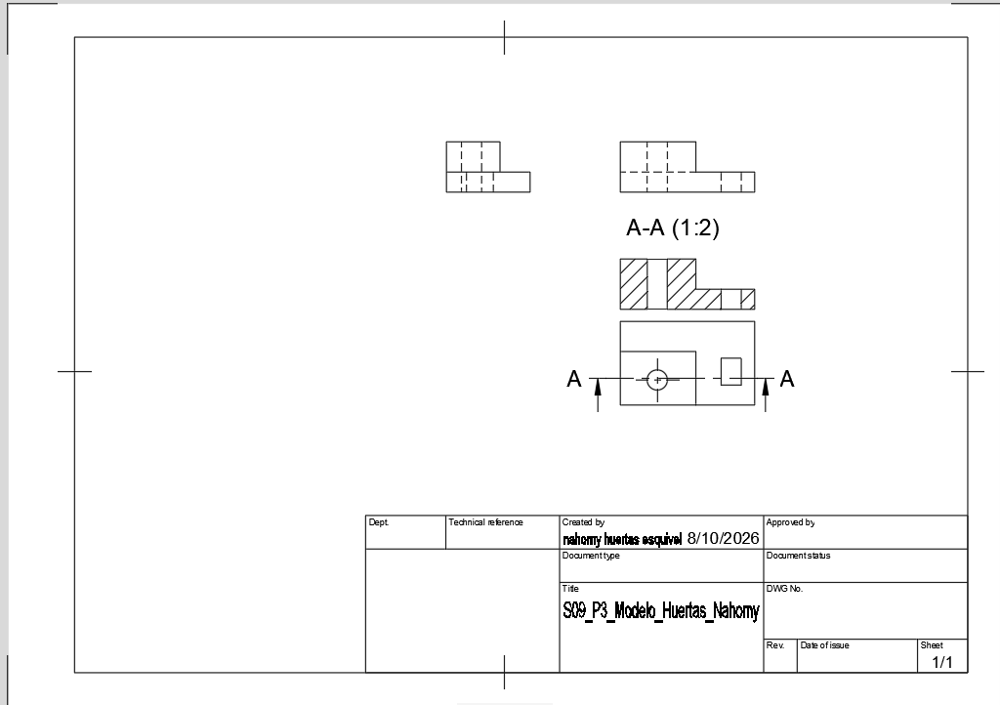

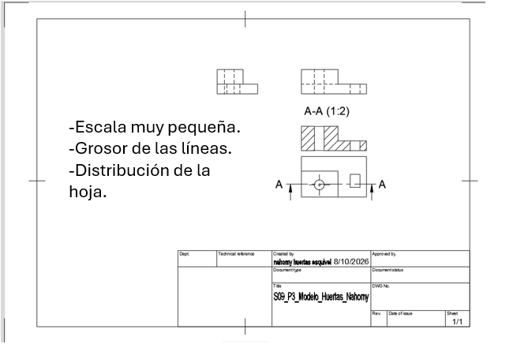

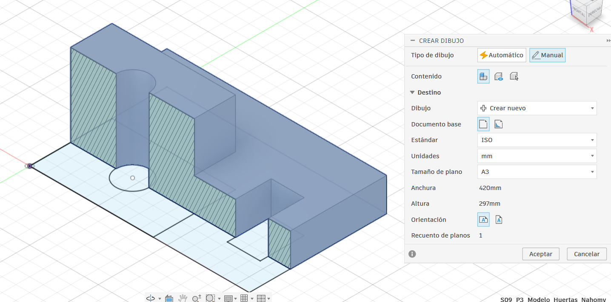

## P2 — Aplicación de hoja, distribución y cajetín

**Propósito:** aplicar el formato seleccionado, organizar la información y completar el cajetín.

**Entorno:** Fusion, espacio `Drawing`. No se modifica la geometría del modelo.

### P2.0 · Pasos en Fusion

1. Abra la versión de P1 y confirme que trabaja sobre el Drawing correcto.
2. Seleccione la hoja en el navegador y ejecute `Edit Sheet` o el comando equivalente.
3. Aplique formato, orientación y unidades seleccionados en P1. Acepte la edición.
4. Mantenga juntas las vistas que comparten dimensiones y reserve espacio para cotas y anotaciones.
5. Reubique vistas sin romper la alineación entre `Front`, `Top` y `Right`.
6. Reubique el corte o la sección sin perder su identificación ni su relación con las vistas.
7. Reubique el detalle ampliado sin separarlo de la vista de origen.
8. Haga clic derecho sobre el cajetín y seleccione `Edit Title Block` o el comando equivalente.
9. Complete código ICT401, título de la pieza, nombre del estudiante, fecha, unidades, escala y los demás campos requeridos por la plantilla.
10. Cierre la edición del cajetín y compruebe que ningún texto invada vistas, cotas, rayado o bordes.
11. Guarde el Drawing en Fusion Cloud.

- **Formato final:** ISO A3 (420 × 297 mm).
- **Orientación:** Horizontal (Landscape).
- **Unidades:** Milímetros (mm).
- **Escala indicada en el cajetín:** 1:1.
- **Escala de las vistas:** 1:1 para las vistas principales y 2:1 para el detalle B.
- **¿Coinciden las escalas?:** Sí. El cajetín indica la escala principal y el detalle tiene su propia escala identificada.
- **Campos completados:** Título, código del curso, autor, fecha, unidades, escala y número de hoja.
- **Código del documento:** ICT401-S12-Huertas_Nahomy.
- **Fecha de entrega:** 13/10/2026.
- **Autor:** Huertas Nahomy.
- **Revisión:** Rev. 02 / Final.
- **Campo no disponible:** No se agregó un nombre de revisor independiente porque no estaba disponible en la plantilla.

### P2.2 · Distribución de las vistas

| Elemento | Ubicación final | ¿Está bien relacionado? | Corrección realizada |
|---|---|---|---|
| Frontal | Centro-izquierda | Sí | Se mantuvo alineada con las vistas Superior y Lateral Derecha. |
| Superior | Parte superior izquierda | Sí | Se colocó encima de la vista Frontal. |
| Lateral Derecha | Centro-derecha | Sí | Se mantuvo a la derecha de la vista Frontal. |
| Sección A-A | Parte inferior central | Sí | Se revisó su alineación con la indicación del corte. |
| Detalle B | Esquina superior derecha | Sí | Se identificó como DETALLE B ESCALA 2:1. |
| Cajetín | Esquina inferior derecha | Sí | Se dejó dentro del marco y sin interferencias con las cotas. |
### Evidencias P2

**Qué debe contener cada imagen:**

- `S12_P2_HojaDistribucion_Apellido_Nombre.png`: Drawing completo con formato aplicado, vistas distribuidas, sección, detalle y cajetín en contexto.
- `S12_P2_Cajetin_Apellido_Nombre.png`: recorte legible del cajetín completo, incluyendo código ICT401, título, autoría, fecha, unidades y escala.
- `S12_P2_Correcciones_Apellido_Nombre.png`: comparación antes/después o lámina que muestre una corrección real de distribución.

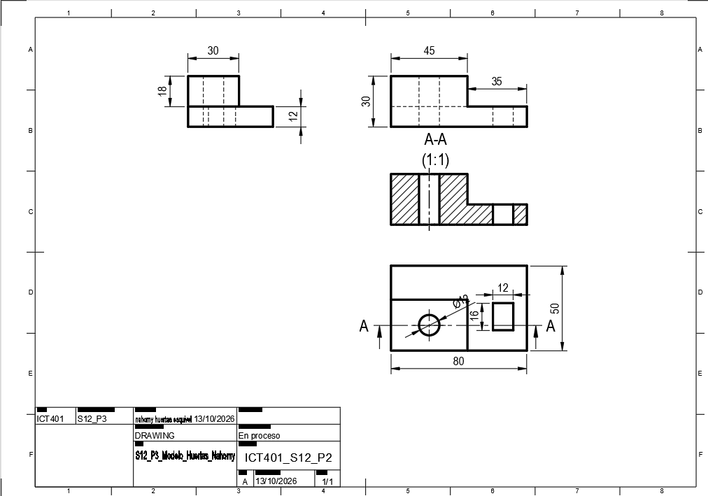

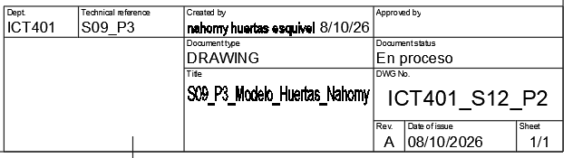

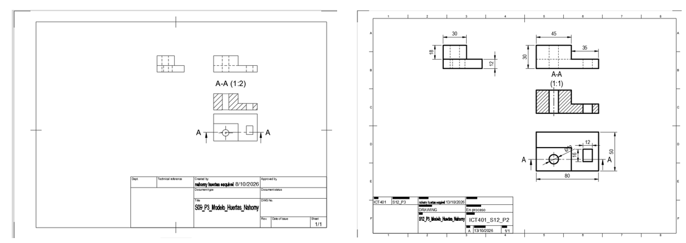

## P3 — Escala, legibilidad y control de anotaciones

**Propósito:** comprobar que la escala permite leer la hoja completa y las zonas con información técnica.

**Entorno:** Fusion, espacio `Drawing`.

### P3.0 · Pasos en Fusion

1. Abra el Drawing de P2 y registre la escala de la hoja y de cada vista.
2. Observe la hoja completa y localice textos, flechas, cotas, rayado o detalles ilegibles.
3. Acerque el zoom para comprobar textos y dimensiones; vuelva a la vista completa para comprobar composición.
4. Verifique que `Front`, `Top` y `Right` sigan alineadas.
5. Verifique que el corte conserve su identificación y que el detalle tenga letra y escala.
6. Si una vista requiere otra escala, selecciónela y modifique la propiedad de escala desde el panel de Fusion. No la redimensione arrastrando sin control.
7. Reubique la vista si invade otra vista, una cota, el cajetín o el borde de la hoja.
8. Revise que cada cota se asocie con una característica y no dependa de una línea oculta.
9. No agregue nuevas tolerancias en P3. Solo revise las que provienen de Semana 11.
10. Guarde cada corrección en la tabla de esta ficha.

### P3.1 · Control de escala

- **Escala anterior:** 1:2.
- **Escala posterior:** 1:1.
- **¿Se modificó la escala?:** Sí.
- **Motivo:** Con la escala 1:2 quedaba demasiado espacio vacío en la hoja A3 y algunas cotas se veían pequeñas. Por eso seleccioné la escala 1:1 para las vistas principales.
- **¿La escala coincide con el cajetín?:** Sí, la escala principal indicada es 1:1.
- **¿Se eliminaron las cotas repetidas?:** Se revisaron las cotas para evitar repeticiones innecesarias.
- **¿Las cotas están ubicadas en zonas claras?:** Se revisó su ubicación y se colocaron las cotas internas en la sección A-A cuando correspondía.

### P3.2 · Control de legibilidad

| Elemento revisado | Problema encontrado | Corrección aplicada | Resultado esperado |
|---|---|---|---|
| Escala | Las vistas se observaban demasiado pequeñas en la hoja. | Se revisó la escala para mejorar el tamaño de las vistas y facilitar la lectura. | Una mejor visualización de la pieza y sus dimensiones. |
| Grosor de las líneas | Los grosores no permitían distinguir claramente todos los elementos del dibujo. | Se revisaron los grosores de línea para diferenciar mejor los contornos y los demás elementos. | Mayor claridad en la representación técnica. |
| Distribución de la hoja | Las vistas no aprovechaban adecuadamente el espacio disponible. | Se reorganizaron las vistas y las anotaciones para mejorar su ubicación. | Una hoja más ordenada y fácil de interpretar. |

### Evidencias P3

**Qué debe contener cada imagen:**

- `S12_P3_HojaCompleta_Apellido_Nombre.png`: hoja completa después de la corrección, sin ocultar el cajetín ni las vistas.
- `S12_P3_Legibilidad_Apellido_Nombre.png`: una lámina con al menos dos recortes ampliados donde se lean cotas y anotaciones.
- `S12_P3_ControlEscala_Apellido_Nombre.png`: escala visible en propiedades de la vista o configuración y escala correspondiente del cajetín.

Si no cambió la escala, la ficha debe explicar por qué la escala inicial conservaba la legibilidad.

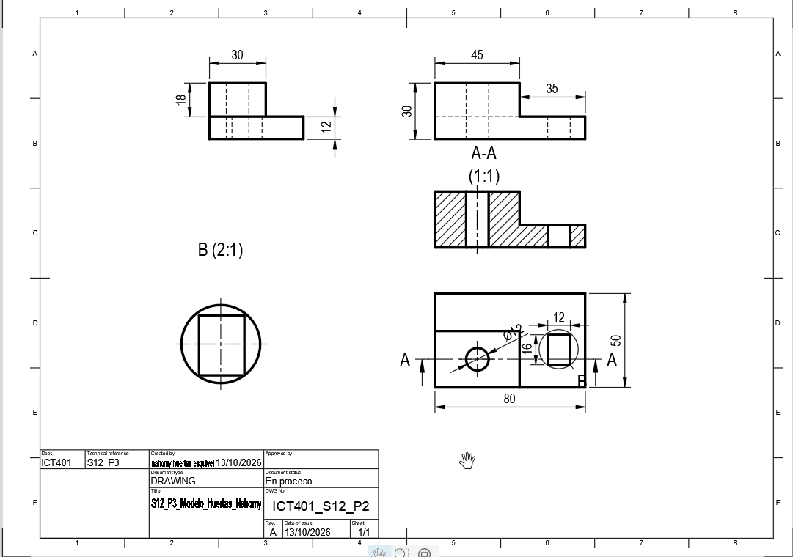

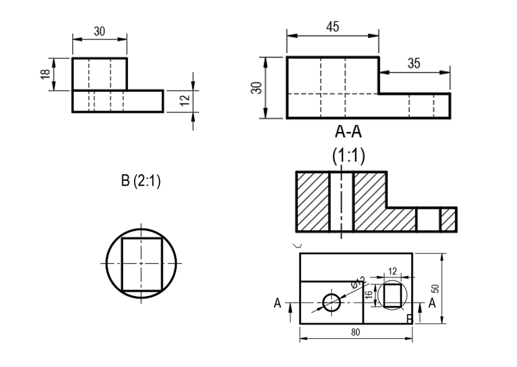

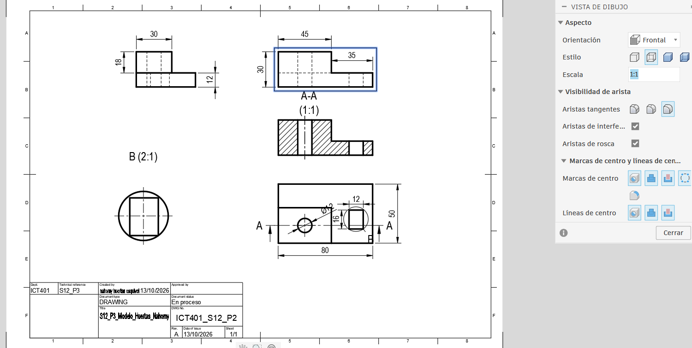

## P4 — Salidas PDF/DXF y previsualización técnica

**Propósito:** generar las salidas solicitadas y comprobar que corresponden al Drawing.

**Entorno:** Fusion, espacio `Drawing`, visor PDF y visor CAD disponible.

### P4.0 · Salida PDF

1. Guarde el Drawing y confirme la hoja activa.
2. Abra `Output` y seleccione `PDF` o el comando equivalente.
3. Seleccione únicamente la hoja final solicitada.
4. Utilice el nombre `S12_PlanoFinal_Apellido_Nombre.pdf`.
5. Guarde el archivo en la carpeta de Semana 12.
6. Abra el PDF fuera de Fusion.
7. Compruebe tamaño de papel, orientación, márgenes, cajetín, vistas, cotas, rayado y detalle.
8. Compare el PDF con el Drawing. Si aparece recortado, girado, vacío o deformado, repita la exportación después de corregir la configuración.

### P4.1 · Salida DXF

1. Genere el DXF solamente si la plantilla o la rúbrica lo solicita.
2. En `Output`, seleccione `DXF` o el comando equivalente.
3. Confirme hoja, unidades, nombre y opciones de exportación.
4. Utilice el nombre `S12_PlanoFinal_Apellido_Nombre.dxf`.
5. Guarde el archivo en la carpeta de Semana 12.
6. Abra o previsualice el DXF en el programa disponible.
7. Compruebe que corresponde al Drawing y registre qué elementos contiene.
8. No convierta el archivo con otra herramienta para ocultar una discrepancia. Registre la limitación y consulte si la salida disponible no coincide con la rúbrica.

### P4.2 · Registro de exportación

| Archivo | Comando utilizado | Unidades | Hoja/orientación | ¿Coincide con Drawing? | Corrección |
|---|---|---|---|---|---|
| PDF | Exportar como PDF | Milímetros (mm) | ISO A3, horizontal | Sí, si conserva la misma distribución y escala del Drawing | Revisar que las vistas, las cotas y los grosores de línea se vean correctamente. |
| DXF | Exportar como DXF | Milímetros (mm) | Según la configuración de exportación | No solicitado, si no se pidió este formato | Verificar las unidades y la escala si se necesita entregar este archivo. |

### Evidencias P4

**Qué debe contener cada imagen:**

- `S12_P4_Drawing_Apellido_Nombre.png`: hoja final en Fusion antes de exportar.
- `S12_P4_PDF_Apellido_Nombre.png`: PDF abierto, con hoja, cajetín y contenido técnico visibles.
- `S12_P4_DXF_Apellido_Nombre.png`: DXF abierto o ventana de exportación con nombre y unidades, cuando se solicite.
- `S12_P4_Comparacion_Apellido_Nombre.png`: una sola lámina con recortes etiquetados `Fusion Drawing`, `PDF` y `DXF`.

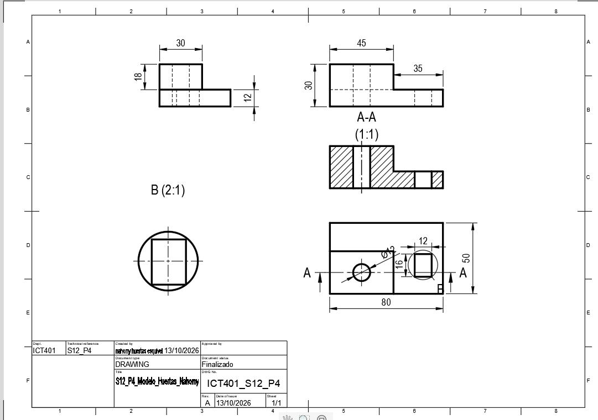

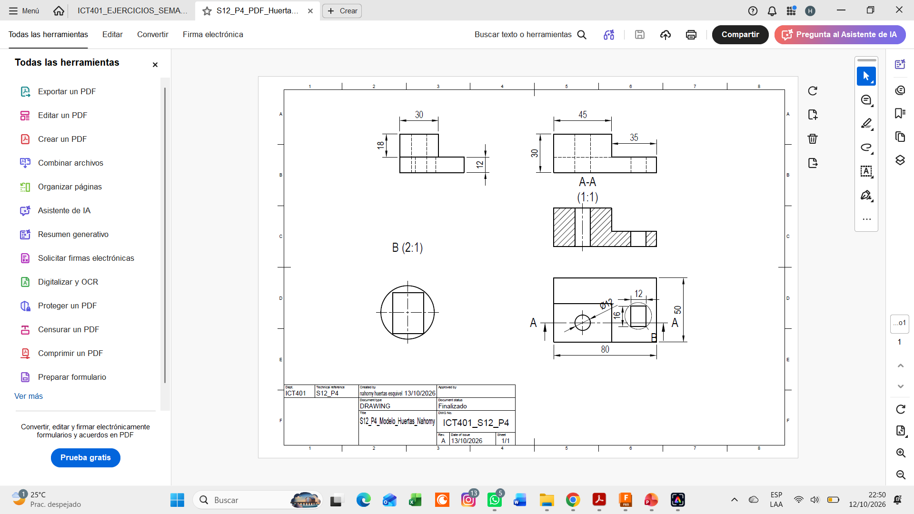

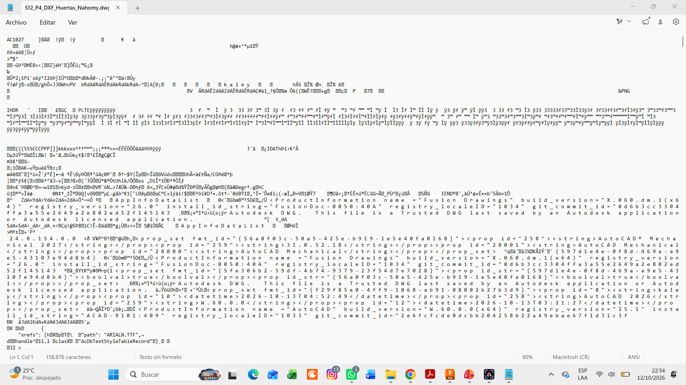

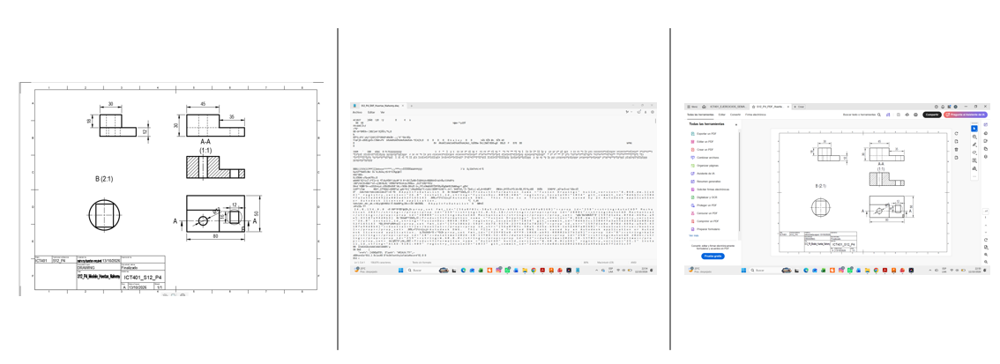

## P5 — Laboratorio integrador II-A, impresión y entrega

**Propósito:** integrar, revisar y entregar el plano técnico completo a partir del Drawing corregido en P1–P4. P5 es evaluativo; no cree un plano nuevo ni repita el proceso desde cero.

**Valor:** Laboratorio integrador II-A, 10 %. La Fase 2 del Proyecto tiene valor de 7 % y se entrega según su enunciado y rúbrica oficiales.

### P5.0 · Pasos en Fusion

1. Abra el Drawing que conserva las correcciones de P1 a P4.
2. Confirme que el modelo y el Drawing pertenecen al mismo proyecto y pieza.
3. Revise en la hoja completa formato, orientación, márgenes y distribución.
4. Revise el cajetín: código ICT401, título, autoría, fecha, unidades, escala y campos de la plantilla.
5. Revise alineación de `Front`, `Top` y `Right`, sección, detalle, cotas y tolerancias.
6. Cambie a `Design` y compare una característica visible del plano con el modelo 3D.
7. Registre cualquier discrepancia; no maquille el Drawing para que coincida visualmente.
8. Regrese a `Drawing` y aplique la corrección indicada por la revisión.
9. Ejecute `Output > PDF`, abra el PDF y compruebe que no hay recortes ni deformaciones.
10. Ejecute `Output > DXF` únicamente si corresponde y revise su contenido.
11. Abra `Output > Print` o la previsualización de impresión.
12. Compruebe papel, orientación, escala, márgenes y ausencia de recorte. Si se exige escala técnica, no seleccione `Fit to page`.
13. Guarde el Drawing en Fusion Cloud y confirme acceso docente.
14. Organice ficha, imágenes, PDF, DXF y enlaces en la carpeta oficial.
15. Complete el checklist final y registre los pendientes reales.

### P5.1 · Checklist

- [x] El modelo y el Drawing corresponden a la misma pieza.
- [x] El formato y la orientación son adecuados.
- [x] El cajetín está completo y legible.
- [x] El formato, marco y zona de identificación fueron revisados con el criterio de ISO 5457.
- [x] Los campos del cajetín fueron contrastados con INTE/ISO 7200:2008 y las limitaciones quedaron registradas.
- [x] La escala del cajetín coincide con la configuración del plano.
- [x] Las vistas están alineadas y no falta información necesaria.
- [x] El corte, la sección y el detalle conservan su identificación.
- [x] Las cotas y tolerancias son legibles y no están superpuestas.
- [x] Las cotas necesarias aparecen una sola vez, salvo indicación auxiliar, y se revisaron con ISO 129-1.
- [x] El PDF abre correctamente y coincide con el Drawing.
- [x] El DXF fue generado y revisado cuando corresponde.
- [x] La previsualización de impresión no presenta recortes ni deformaciones.
- [x] La ficha y las imágenes tienen la nomenclatura solicitada.
- [x] El enlace de Fusion Cloud tiene acceso docente.
- [x] Modelo, Drawing y archivos exportados no presentan contradicciones y la revisión o versión quedó identificada.
- [x] La Fase 2 del Proyecto fue entregada según su enunciado.

### P5.2 · Revisión por pares

| Criterio | Observación recibida | Cambio realizado |
|---|---|---|
| Formato y orientación | El formato A3 ofrecía más espacio para organizar el plano. | Se mantuvo el formato A3 horizontal. |
| Cajetín | Era necesario completar el código de la asignatura. | Se agregó ICT401 - Dibujo Técnico CAD. |
| Escala y legibilidad | Las cotas del detalle B eran pequeñas al observar el plano completo. | Se revisó la ubicación de las cotas y el tamaño del texto. |
| Distribución de vistas | La sección A-A estaba un poco desplazada respecto al eje de proyección. | Se ajustó su alineación con las vistas correspondientes. |
| PDF, DXF e impresión | La configuración podía cambiar la escala al utilizar el ajuste automático. | Se revisó la configuración para mantener la escala real cuando correspondía. |

### Evidencias P5

**Qué debe contener cada imagen:**

- `S12_P5_PlanoFinal_Apellido_Nombre.png`: hoja completa en Fusion, con cajetín legible y todos los elementos del plano.
- `S12_P5_VerificacionModelo_Apellido_Nombre.png`: comparación etiquetada entre `Drawing` y `Design`, con una orientación que permita comprobar una característica representada.
- `S12_P5_PrevisualizacionImpresion_Apellido_Nombre.png`: previsualización con papel, orientación, escala y márgenes visibles.
- `S12_P5_Entrega_Apellido_Nombre.png`: carpeta o plataforma oficial de entrega mostrando ficha, PDF, DXF cuando corresponda y archivos organizados.

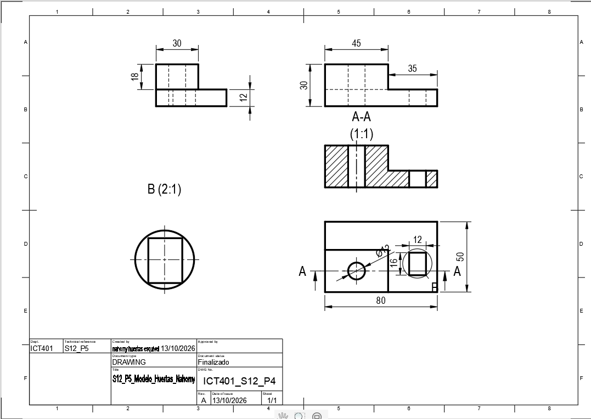

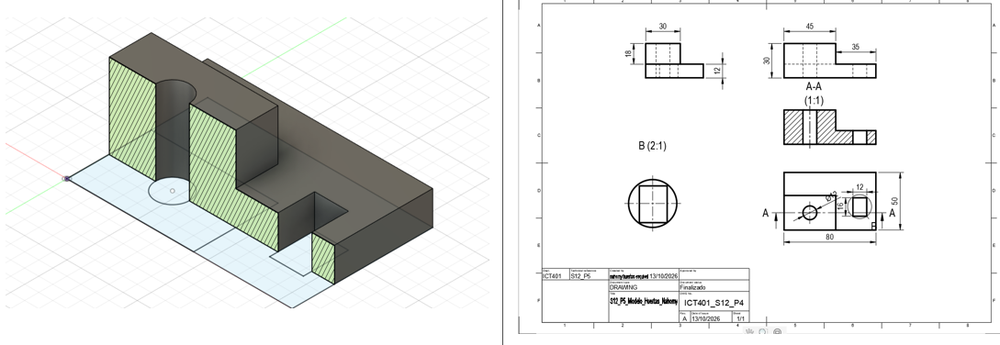

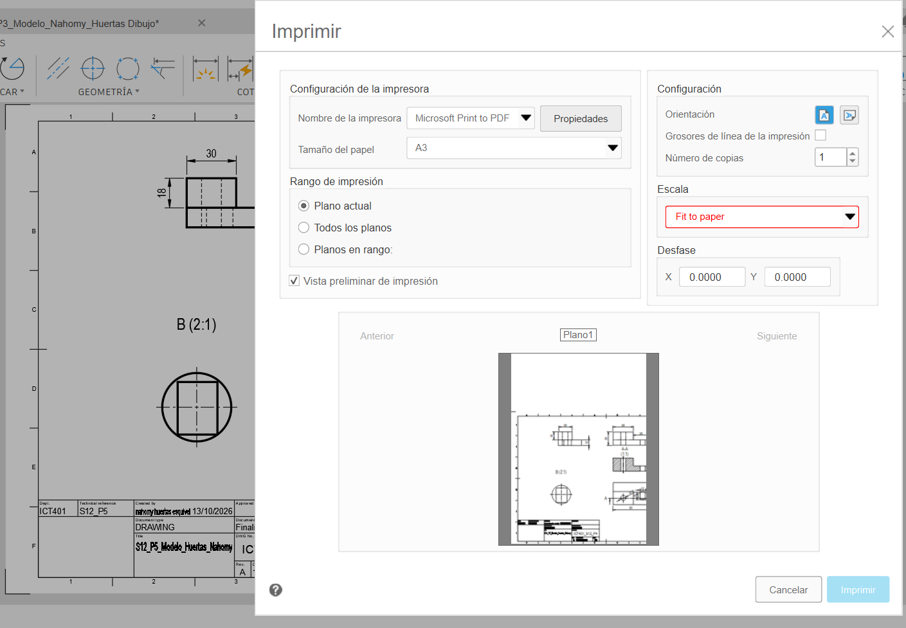

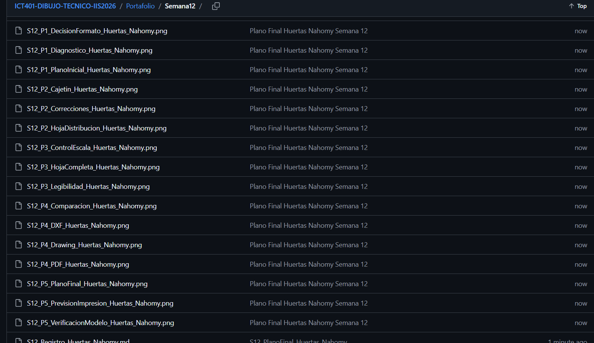

## Reflexión final

### 1. ¿Por qué el formato seleccionado es adecuado para este plano?

Elegí el formato ISO A3 horizontal porque tiene más espacio para distribuir las vistas principales, la sección A-A y el detalle B. De esta manera, se pueden organizar mejor las cotas y evitar que la información quede amontonada.

### 2. ¿Qué información del cajetín identifica el plano?

El cajetín permite identificar la pieza y el documento mediante el título, el código de la asignatura, el nombre del autor, la fecha, las unidades, la escala y la revisión del plano.

### 3. ¿Qué problema de escala o legibilidad encontré y cómo lo solucioné?

Al principio, el plano estaba en formato A4 y las cotas quedaban muy juntas. Para solucionarlo, seleccioné el formato A3 y organicé las vistas principales a escala 1:1, dejando el detalle B a escala 2:1 para que se pudiera apreciar mejor.

### 4. ¿Qué diferencia encontré entre el Drawing y los archivos exportados?

Comparé el Drawing con los archivos exportados para comprobar que conservaran la información técnica. En el DXF también era importante revisar cómo se representaban los textos, las cotas y los rayados.

### 5. ¿Cómo comprobé que la impresión no deformara ni recortara el plano?

Revisé la previsualización de impresión para comprobar el tamaño del papel, la orientación y los márgenes. También verifiqué que la escala se mantuviera según lo solicitado y que todas las partes del plano fueran visibles.

### 6. ¿Qué corrección mejoró más la calidad del plano?

Considero que el cambio al formato A3 y la reorganización de las cotas fueron los cambios más importantes, porque permitieron aprovechar mejor el espacio y facilitaron la lectura de las medidas y las vistas.

## Cierre de la ficha

- [x] Completé las respuestas de P1 a P5.
- [x] Incorporé todas las evidencias con la nomenclatura solicitada.
- [x] Las imágenes se visualizan correctamente desde el medio oficial de entrega.
- [x] El PDF fue abierto y comparado con el Drawing.
- [x] El DXF fue revisado cuando correspondía.
- [x] El modelo y el Drawing están disponibles en Fusion Cloud con acceso docente.
- [x] Documenté las correcciones sin borrar decisiones iniciales.
- [x] La Fase 2 del Proyecto fue organizada según su rúbrica.
- [x] Entregué los últimos cambios mediante el medio oficial indicado.

Nombre sugerido para la entrega: `S12_PlanoFinal_Apellido_Nombre`.

Si realiza una corrección posterior, conserve la versión anterior y utilice una identificación que permita distinguir la nueva entrega.
