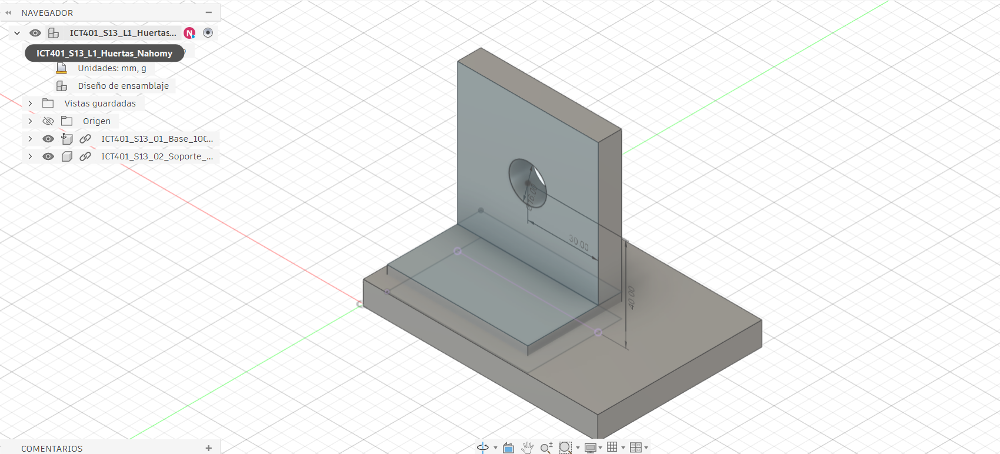
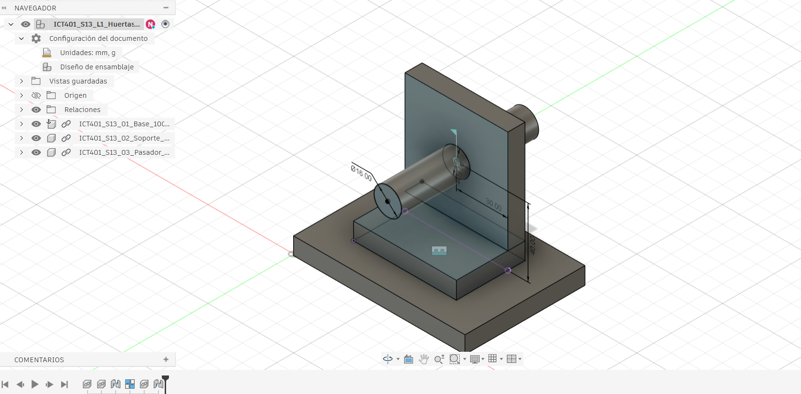
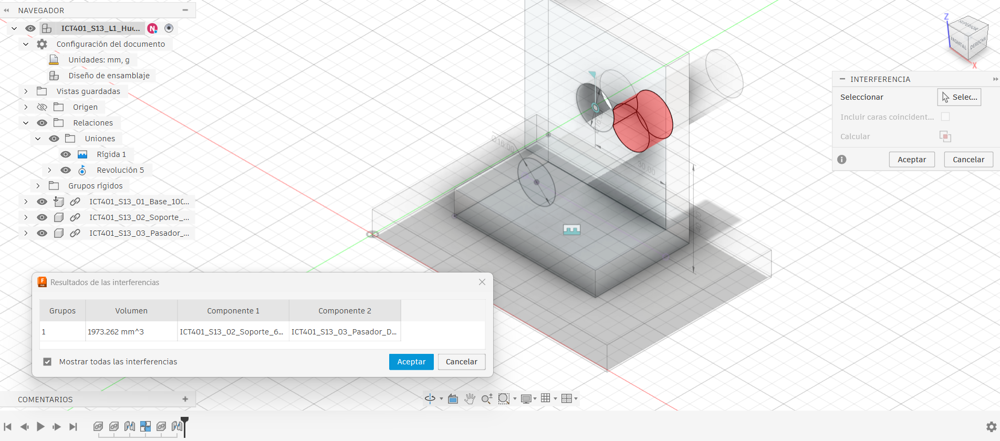
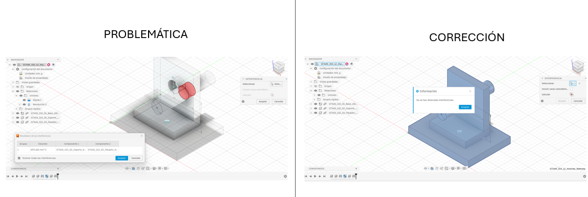

# ICT401 · Semana 13 — Registro de ensamblaje básico

12 al 17 de octubre de 2026.

- Estudiante: Nahomy Huertas Esquivel
- Grupo: 60
- Proyecto de Fusion Cloud con acceso docente: Nahomy Huertas
- Nombre del diseño de ensamblaje: ICT401_S13_L1-L4_Huertas_Nahomy
- Piezas base utilizadas: ICT401_S13_01_Base_100x70x10, ICT401_S13_02_Soporte_60x70x40 y ICT401_S13_03_Pasador_D16x80.
- Fecha de trabajo de laboratorio: 15/10/2026

## Instrucciones

Utilice esta plantilla en `Portafolio/semana13/` y guárdela como `S13_Registro_Apellido_Nombre.md`. Sustituya `Apellido_Nombre` por un apellido y un nombre sin espacios ni tildes. Complete cada `[Respuesta]` durante las cuatro lecciones prácticas y agregue las imágenes solicitadas junto con la ficha.

La sesión virtual del miércoles se dedica a la revisión oral del Proyecto Integrador. Este registro corresponde únicamente a las cuatro lecciones prácticas de laboratorio. La actividad es formativa y no sustituye las evaluaciones oficiales posteriores.

Trabaje con las piezas base proporcionadas por la persona docente. Si todavía no se han distribuido, use las imágenes PNG y las dimensiones de esta ficha para construirlas. No modifique los archivos originales ni oculte un componente para evitar una interferencia. Si su versión de Fusion utiliza otro nombre de comando, escriba el nombre real utilizado y describa su función.

Ayuda oficial de Fusion: [Fusion Help](https://help.autodesk.com/view/fusion360/ENU/), sección `Assemblies`.

## Conjunto de trabajo

Dimensiones nominales de referencia: base maciza `100 x 70 x 10 mm`; soporte de `60 mm` de ancho, `70 mm` de alto y `40 mm` de fondo, con alojamiento pasante `diametro 16 mm`; pasador `diametro 16 x 80 mm`.

### Posicionamiento exacto

El soporte se centra sobre la base, no se coloca en una esquina:

- Margen lateral: `20 mm` a cada lado, porque `(100 - 60) / 2 = 20 mm`.
- Margen frontal y posterior: `15 mm` a cada lado, porque `(70 - 40) / 2 = 15 mm`.
- Cara inferior del soporte coincidente con la cara superior de la base.
- Relación base-soporte: `Rígida (Rigid)`.
- Centro del alojamiento: `40 mm` desde la cara inferior del soporte y `30 mm` desde cada lado del soporte.
- Pasador: coaxial con el alojamiento, centrado en el espesor de la pared y con relación `Revolute (Revoluta)`.
- Si la pared mide `10 mm`, el pasador de `80 mm` sobresale aproximadamente `35 mm` a cada lado.

No registre una distancia desde una esquina para ubicar el pasador. Su posición queda definida por el centro del alojamiento.

| Componente | Nombre en Fusion | Función dentro del conjunto | Observación inicial |
|---|---|---|---|
| Base | ICT401_S13_01_Base_100x70x10 | base de apoyo para el ensamblaje y sostener el soporte | colocación horizontalmente y sirve como referencia para posicionar los demás componentes |
| Soporte vertical | ICT401_S13_02_Soporte_60x70x40 | sostener el pasador y mantenerlo en la posición correspondiente. | colocado verticalmente sobre la base |
| Eje o pasador | ICT401_S13_03_Pasador_D16x80. | insertarse en el soporte y permitir el movimiento giratorio con unión de revolución. | ubicarlo en el soporte y establecer la relación entre ambos componentes. |

## Comandos bilingues de Fusion

| Accion | Ruta o comando | Resultado esperado |
|---|---|---|
| Crear diseño | `Archivo > Nuevo diseño (File > New Design)` | Diseño vacío y proyecto confirmado en el Panel de datos. |
| Insertar pieza | `Insertar en el diseño actual (Insert into Current Design)` | Componente visible en el Navegador. |
| Fijar base | Clic derecho en Navegador > `Fijar (Ground)` | La base no se desplaza ni gira. |
| Relacionar soporte | `Ensamblar > Unión (Assemble > Joint)` > `Rígida (Rigid)` | El soporte queda unido a la base. |
| Relacionar pasador | `Ensamblar > Unión (Assemble > Joint)` > `Revoluta (Revolute)` | El pasador gira alrededor de su eje. |
| Probar relación | Clic derecho en la unión > `Animar unión (Drive Joint)` | Se comprueba el movimiento permitido. |
| Revisar interferencias | `Inspeccionar > Interferencia (Inspect > Interference)` > `Calcular (Compute)` | Se identifican cuerpos que ocupan el mismo volumen. |
| Editar relación | Clic derecho en la relación > `Editar (Edit)` | Se corrige origen, orientación, tipo o desplazamiento. |

Registre en cada lección qué componente seleccionó, qué comando utilizó y qué resultado observó. No se considera suficiente escribir solo el nombre de la herramienta.

## L1 — Reconocimiento de piezas y componente base

### Diagnóstico

- ¿Qué pieza funcionará como base y por qué?:  La pieza base 100 × 70 × 10 mm porque sirve como apoyo para el soporte y mantiene estable el ensamblaje.
- ¿Qué superficies de la base y del soporte podrían entrar en contacto?: La superficie superior de la base y la superficie inferior del soporte.
- ¿Qué eje o alojamiento utilizará el pasador?: El agujero de diámetro 16 mm del soporte, donde se ubica el pasador.
- ¿Qué movimiento estaba libre antes de aplicar relaciones?: Los componentes podían desplazarse o cambiar de orientación antes de establecer las relaciones correspondientes.
- ¿Qué orientación inicial seleccionó y por qué?: La base horizontal y el soporte vertical para mantener una posición estable, también alinear el pasador con el agujero del soporte para facilitar su unión y permitir que gire correctamente.

### Estado inicial

| Comprobación | Resultado |
|---|---|
| Base insertada como componente | Sí, la base aparece en el navegador de componentes. |
| Base fija o establecida como referencia | Si se utilizó el comando Fijar (Ground). |
| Soporte insertado | Sí, el soporte aparece como componente del ensamblaje. |
| Eje o pasador disponible | Sí, el pasador está disponible. |
| Nombres identificables en el navegador | Sí, se observan los componentes de la base, 0soporte y pasador. |

### Evidencia L1

`S13_PiezasBase_Apellido_Nombre.png`: captura del ensamblaje con la base y el soporte visibles, el navegador de componentes abierto y los nombres identificables.

## L2 — Relaciones entre componentes

### Decisiones

| Relación | Componentes o geometrías vinculadas | Movimiento que elimina | Movimiento que conserva | Resultado |
|---|---|---|---|---|
| Rígida 1 | Base y soporte | Elimina el movimiento relativo de traslación y rotación entre los componentes. | Ninguno entre la base y el soporte. | Mantiene el soporte en una posición fija respecto a la base. |
| Revolución 5 | Soporte y pasador | Elimina las rotaciones que no corresponden al eje de la unión. | Giro alrededor del eje de revolución. | Permite el movimiento giratorio del pasador. |

- Comando o herramienta utilizada: union rígida y de revolución
- ¿Por qué esa relación representa la intención del conjunto?: la unión rígida mantiene el soporte unido a la base, mientras que la unión de revolución permite el giro del pasador alrededor de su eje
- ¿La orientación del soporte quedó correcta?: sí, según la captura del ensamblaje final, el soporte se observa en posición vertical sobre la base.
- ¿Qué movimiento debe conservar el eje?: un giro alrededor de su propio eje.
- ¿Qué movimiento inesperado observó y cómo lo corrigió?: no hubieron movimientos inesperados.
- 
### Evidencia L2

`S13_Relaciones_Apellido_Nombre.png`: captura del navegador de componentes y de la relación aplicada, con el conjunto orientado para leer la posición del soporte y del eje.

## L3 — Revisión de interferencias

- Herramienta utilizada: análisis de interferencias
- Componentes comparados: soporte, pasador y base.
- ¿Se encontró una interferencia?: si
- Ubicación de la condición: zona de unión entre el soporte y el pasador.
- ¿Se trata de interferencia, contacto previsto o separación intencional?: el análisis inicial no reportó interferencia entre los componentes, entonces se modificó la ubicación del pasador para encontrar una. 
- Causa probable: posición relativa incorrecta entre el soporte y el pasador.
- ¿Qué efecto tendría sobre el funcionamiento del conjunto?: podría impedir el movimiento previsto del pasador.

  
| Componente A | Componente B | Zona revisada | Resultado | Evidencia |
|---|---|---|---|---|
| Soporte | Pasador | Zona de inserción entre el pasador y el soporte | Interferencia de 1973.262 mm³ | S13_Interferencia_Huertas_Nahomy.png |

### Evidencia L3

`S13_Interferencia_Apellido_Nombre.png`: captura del análisis o de la zona problemática, con los componentes involucrados identificables.

## L4 — Corrección, verificación y cierre

### Registro de corrección

- Problema seleccionado: interferencia entre el soporte y el pasador.
- Corrección prevista antes de modificar: revisar la posición relativa de los componentes y la unión aplicada.
- Componente o relación modificada: se revisó el ensamblaje para corregir la condición detectada.
- Cambio aplicado: se ajustó el ensamblaje del pasador en el soporte como estaba inicialmente.
- Resultado del segundo análisis: No se detectaron interferencias
- ¿La base continúa estable?: sí
- ¿El soporte conserva su orientación?: sí
- ¿El eje conserva el movimiento esperado?: sí
- Versión o nombre final en Fusion Cloud: ICT401_S13_L1-L4_Huertas_Nahomy

| Comprobación final | Resultado | Evidencia o explicación |
|---|---|---|
| Componentes visibles y nombrados | Completado | Se identifican la base, el soporte y el pasador en el navegador. |
| Relaciones comprensibles | Completado | Se observan las relaciones Rígida 1 y Revolución 5. |
| Movimiento esperado | Completado| Se observa con la union de revolucion, para verlo girar se presiona click derecho sobre la relación y "animar unión"
| Interferencia revisada | Completado | El análisis final indica que no se detectaron interferencias. |
| Corrección documentada | Completado | Se cuenta con capturas del análisis inicial y del resultado final. |

### Evidencia L4

`S13_Correccion_Apellido_Nombre.png`: captura comparativa o lámina con el estado problemático y el estado corregido, ambos etiquetados.

## Checklist de cierre

- [x] Las tres piezas base corresponden al conjunto indicado.
- [x] La base está fija o definida como referencia.
- [x] Los componentes tienen nombres identificables.
- [x] Cada relación aplicada tiene una intención explicable.
- [x] El movimiento permitido corresponde a la función del conjunto.
- [x] Se ejecutó una revisión de interferencias.
- [x] La interferencia o ausencia de interferencia quedó interpretada.
- [x] La corrección quedó registrada antes y después.
- [x] El ensamblaje fue guardado en Fusion Cloud.
- [x] La ficha y las imágenes utilizan la nomenclatura solicitada.
- [x] No se adelantaron vistas explosionadas ni listas de componentes.

## Reflexión final

1. ¿Qué diferencia encontró entre insertar piezas y construir un ensamblaje con relaciones?: que insertar piezas consiste en agregar los componentes al diseño, mientras que construir un ensamblaje son relaciones que permiten definir cómo se conectan, posición y movimientos que pueden realizar
2. ¿Qué relación fue más difícil de definir y por qué?: la relación entre el eje del soporte y el eje del pasador fue la más difícil de definir, porque al intentar establecer una distancia de 40 mm desde la cara inferior del soporte, el pasador no quedaba en la distancia correcta. 
3. ¿Cómo distinguió una interferencia de un contacto previsto?: Utilicé el análisis de interferencias para identificar si componentes ocupaban el mismo espacio. En mi caso, el análisis inicial no detectó una interferencia, se le hizo una modificación y detectó interferencia entre el soporte y el pasador de 1973.262 mm³. 
4. ¿Qué comprobará en Semana 14 antes de generar una vista explosionada o una lista de componentes?: que todas las piezas estén correctamente posicionadas, que las relaciones entre los componentes funcionen como se espera y que no existan interferencias en el ensamblaje final.

## Revisión docente

- Observación sobre componentes y nombres: [Respuesta]
- Observación sobre relaciones: [Respuesta]
- Observación sobre interferencias: [Respuesta]
- Corrección sugerida: [Respuesta]
- Estado del registro: [Pendiente/Completo]
  
## Checklist de cierre

- [ ] Las tres piezas base corresponden al conjunto indicado.
- [ ] La base está fija o definida como referencia.
- [ ] Los componentes tienen nombres identificables.
- [ ] Cada relación aplicada tiene una intención explicable.
- [ ] El movimiento permitido corresponde a la función del conjunto.
- [ ] Se ejecutó una revisión de interferencias.
- [ ] La interferencia o ausencia de interferencia quedó interpretada.
- [ ] La corrección quedó registrada antes y después.
- [ ] El ensamblaje fue guardado en Fusion Cloud.
- [ ] La ficha y las imágenes utilizan la nomenclatura solicitada.
- [ ] No se adelantaron vistas explosionadas ni listas de componentes.

