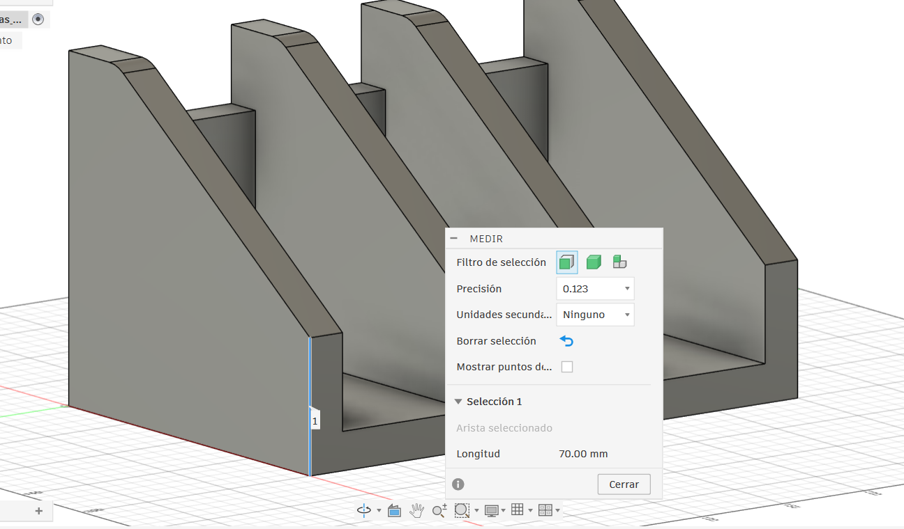
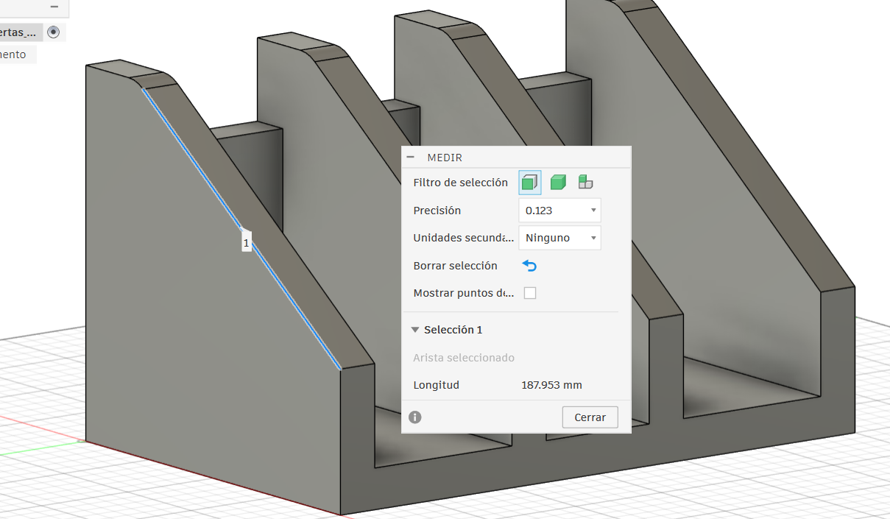
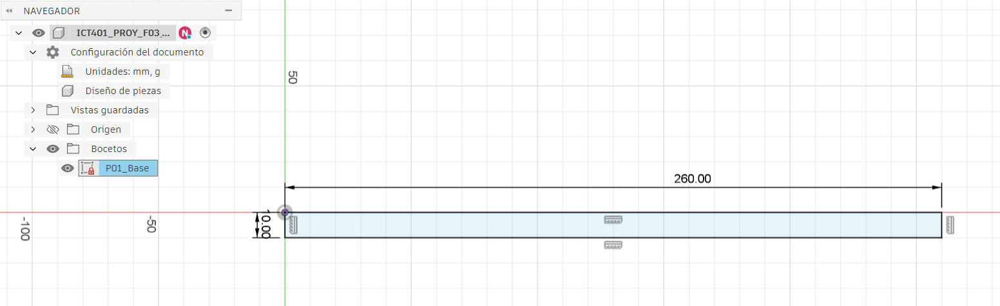
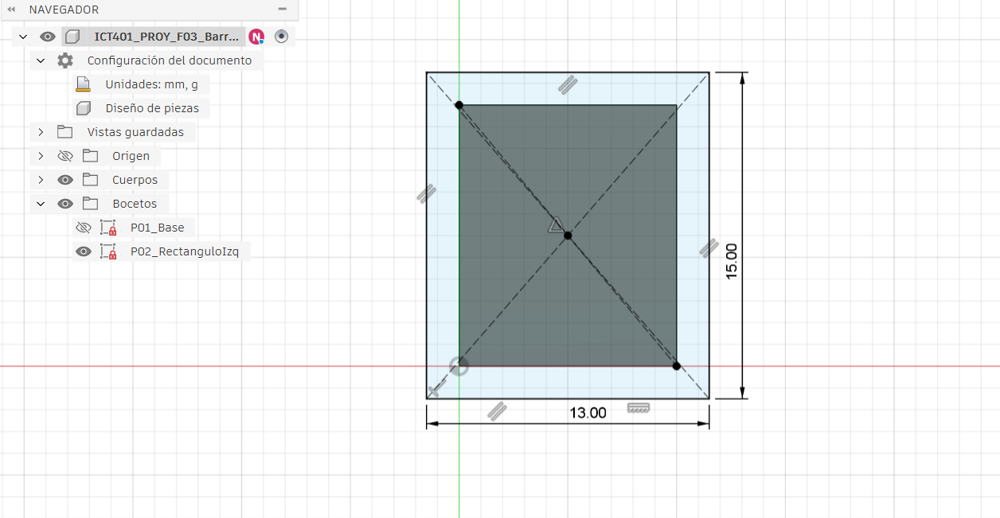
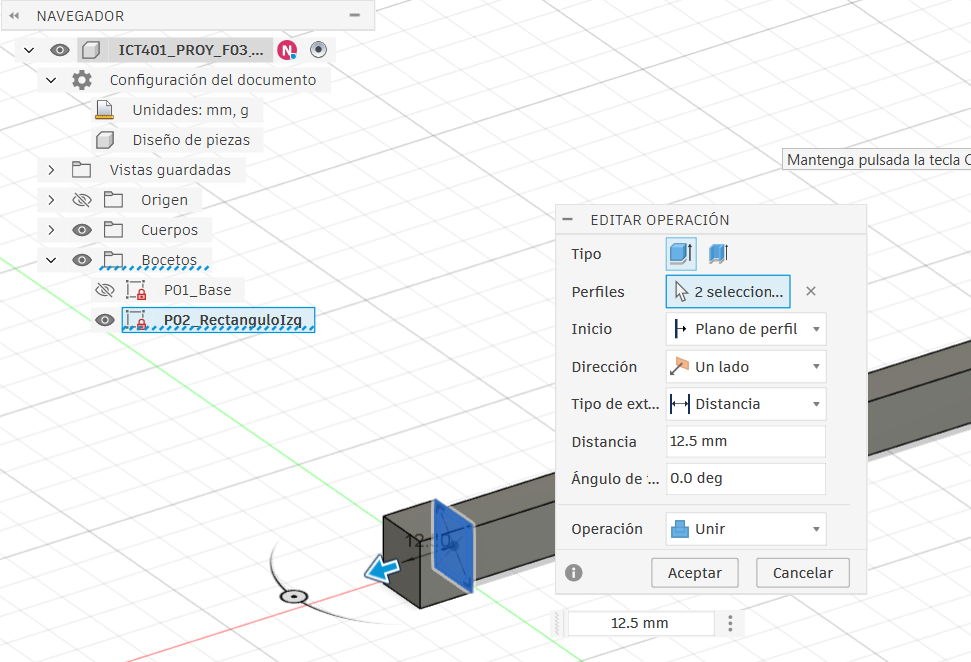
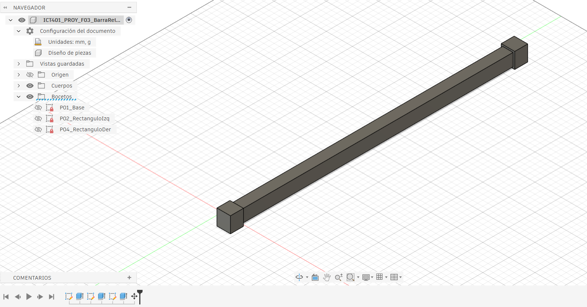
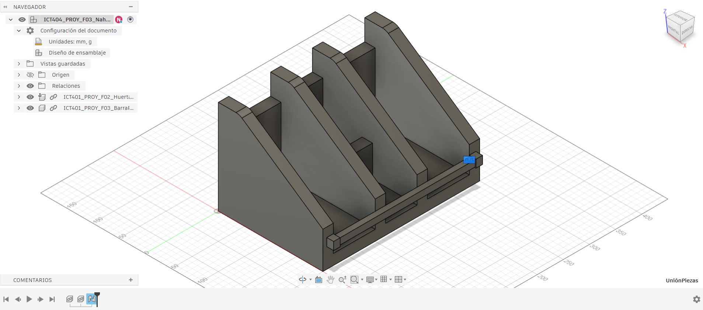
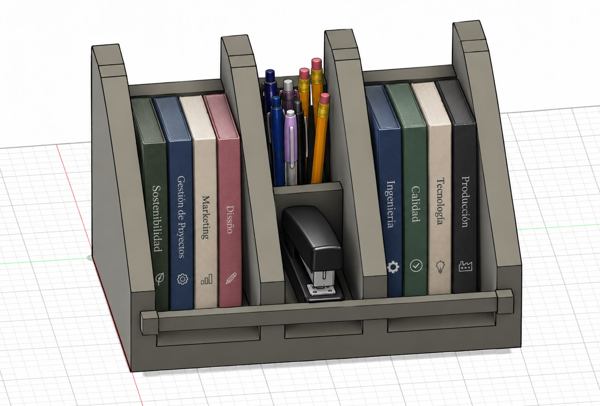

# Fase 3: Integración y validación en Autodesk Fusion 

---

## Archivos de Autodesk Fusion 

Los archivos correspondientes al proyecto se encuentran en la carpeta de Fusion llamada `Nahomy Huertas`.

| Archivo | Descripción |
|---|---|
| `ICT401_PROY_F02_Huertas_Nahomy_Organizador_Libros` | Pieza original del organizador de libros y cuadernos, utilizada como base para realizar las modificaciones y uniones. |
| `ICT401_PROY_F03_BarraRetención` | Archivo correspondiente a la pieza individual de la barra de retención. |
| `ICT401_PROY_F03_NahomyHuertas` | Archivo del ensamblaje final, que contiene el organizador y la barra de retención unidos mediante una relación de unión. |

---

## 1. Información general

| Campo | Información |
|---|---|
| Proyecto | Organizador de escritorio para libros y cuadernos |
| Fase | 3 |
| Software | Autodesk Fusion |
| Estudiante | Nahomy Marcela Huertas Esquivel |
| Curso | Dibujo Técnico Asistido por Computadoras |
| Fecha de entrega | Semana 14 |

## 2. Descripción del proyecto

En esta fase se realizaron modificaciones al modelo original del organizador de escritorio para libros y cuadernos. Se ajustó la longitud de las formas diagonales y se diseñó una barra de retención como pieza independiente, cuya función es ayudar a mantener los libros en su lugar y evitar que se deslicen. Luego, se ingresó al entorno de diseño de ensamblaje de Autodesk Fusion, donde se insertaron el organizador y la barra de retención, ambas piezas se unieron mediante la opción **Relación > Unión**, manteniendo la barra en una posición fija dentro del conjunto.

## 3. Dimensiones del modelo

Se conservaron las dimensiones del organizador documentadas en la Fase 2, excepto por la modificación realizada en las formas diagonales. También se definieron las dimensiones de la nueva barra de retención.

| Elemento | Dimensión |
|---|---|
| Base del organizador | 300 mm × 200 mm |
| Cuatro paredes | 160mm de altura x 20mm de grosor | 
| Pared Trasera |  120mm de altura x 20mm de grosor | 
| Divisiones Internas | 80 mm (Entre paredes IZQ y DER) y espacio en medio 60mm| 
| División compartimento | 75mm distancia entre pared trasera x 20mm grosor |
| Cortes diagonales | 187.953mm | 
| Base de la barra de retención | 260 mm de largo × 10 mm de ancho y 10mm de extrusión |
| Rectángulos laterales de la barra | 13 mm de ancho × 15 mm de largo |
| Extrusión de los rectángulos laterales | 12,5 mm |

Las demás dimensiones del organizador se mantienen como fueron documentadas en la Fase 2.

## 4. Procedimiento de modelado y ensamblaje

### Croquis inicial

Aquí se inserta la captura del croquis utilizado como referencia inicial del modelado de la pieza.

### 4.1. Modificación de las formas diagonales

Primero, se modificaron las formas diagonales de la pieza original del organizador. Se ajustó su longitud a 70 mm, manteniendo el ancho de 20 mm.

**Evidencia 1. Longitud de las formas diagonales**

**Evidencia 2. Ancho de las formas diagonales**

### 4.2. Creación de la barra de retención

Después, se creó la barra de retención como una pieza individual. Se realizó un boceto rectangular con una longitud de 260 mm y un ancho de 10 mm. Para después aplicar una extrusión para obtener el cuerpo de la pieza.

Esta barra tiene la función de ayudar a mantener los libros en su lugar y evitar que se deslicen hacia el frente. Se diseñó como una pieza fija, no giratoria.

**Evidencia 3. Boceto de la base de la barra de retención**

### 4.3. Creación de los extremos laterales de la barra

En las caras exteriores de ambos lados de la barra se realizaron bocetos rectangulares de 13 mm de ancho y 15 mm de largo. Después, se extruyeron 12,5 mm para formar los extremos laterales de la pieza.

**Evidencia 4. Boceto de los rectángulos laterales**

**Evidencia 5. Extrusión de los rectángulos laterales**

### 4.4. Resultado de la barra de retención

Una vez terminadas las operaciones de modelado, se revisó la geometría de la barra de retención como pieza independiente.

**Evidencia 6. Barra de retención terminada**

### 4.5. Integración de las piezas mediante una relación de unión

Para realizar el ensamblaje, se ingresó al entorno de diseño de ensamblaje de Autodesk Fusion. Primero, se insertó el organizador original y luego se incorporó la barra de retención como una segunda pieza.

A continuación, se utilizó la opción **Relación > Unión** para establecer la relación entre ambas piezas y mantener la barra en la posición definida en el conjunto.

**Evidencia 7. Organizador y barra de retención ensamblados**

### 4.6 Referencia de uso Pieza final

En esta sección se muestra el organizador con libros y cuadernos colocados en sus compartimentos, para demostrar su funcionamiento y la utilidad de la barra de retención.

## 5. Revisión y validación del conjunto

Después de unir las piezas, se revisa que la barra de retención esté correctamente ubicada y que cumpla su función sin bloquear innecesariamente el acceso a los compartimentos.

| Aspecto revisado | Criterio de comprobación | Resultado |
|---|---|---|
| Posición de la barra | La barra queda ubicada en la posición definida para retener los libros. | comprobado |
| Relación de unión | La barra se mantiene fija respecto al organizador. | comprobado |
| Alineación | La barra queda alineada con el organizador. | comprobado |
| Acceso a los compartimentos | La barra permite colocar y retirar los libros. | comprobado |
| Geometría final | Las piezas se integran sin interferencias no deseadas. | comprobado |

## 6. Uso de IA

Para esta fase se utilizó la Inteligencia Artificial para agregar elementos demostrativos del uso de la pieza final, esto para alcanzar un mayor concepto de dicha pieza.

## 7. Conclusión

En esta fase se modificó la longitud de las formas diagonales del organizador y se diseñó una barra de retención como pieza independiente. Luego ambas piezas se integraron en Autodesk Fusion mediante una relación de "unión". La barra de retención se diseñó para evitar que los libros y cuadernos se deslizaran o se salieran del organizador. Además, ayuda a mantenerlos acomodados y brinda un punto de apoyo para su almacenamiento.

## 8. Links de Piezas en Fusion

Pieza organizador solo: https://a360.co/4ydf4xe
Pieza de Barra de retención: https://a360.co/4srKUoP
Pieza final con la unión de ambas: https://a360.co/3UfJsJA

